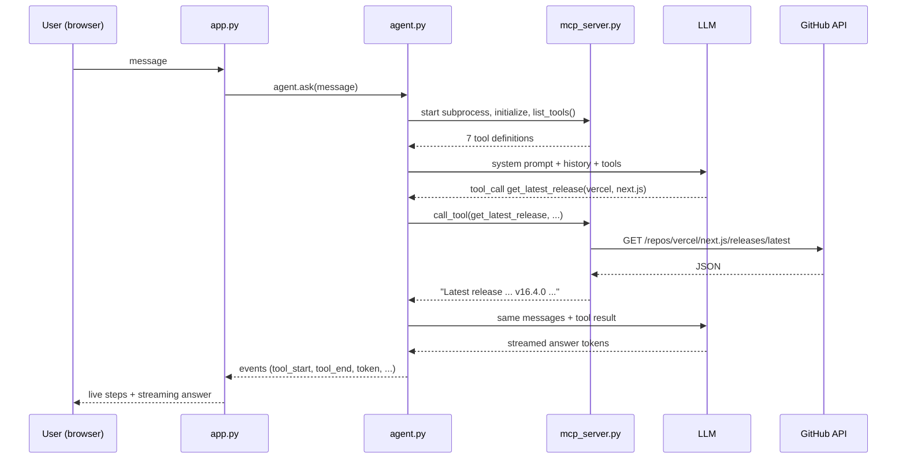

# How gitResearch Works

gitResearch is an AI agent that researches GitHub repositories. You ask it a question in a
chat window, and it decides which live GitHub lookups to make, makes them, and writes an
answer grounded in what it found. Its main job is to answer a question every developer has:
**"Should I depend on this repo?"**

This document explains every feature and how it is implemented, with links to the exact
code.

---

## 1. The big picture

```
┌──────────────┐    ┌──────────────────┐    ┌──────────────────┐    ┌────────────┐
│ Chainlit UI  │ -> │ Agent            │ -> │ MCP server       │ -> │ GitHub     │
│ app.py       │ <- │ agent.py         │ <- │ mcp_server.py    │ <- │ REST API   │
│ (browser)    │    │ (ReAct loop+LLM) │    │ (tools, prompts) │    │            │
└──────────────┘    └──────────────────┘    └──────────────────┘    └────────────┘
                             │
                             v
                      LLM (Groq or Ollama)
```

| File | Lines | Role |
|---|---|---|
| [mcp_server.py](mcp_server.py) | ~330 | **What the agent can do.** 7 GitHub tools, 1 resource, 3 prompt templates |
| [agent.py](agent.py) | ~210 | **How the agent thinks.** LLM client, connection to the MCP server, the ReAct loop |
| [app.py](app.py) | ~210 | **What the user sees.** Chat UI, commands, starter buttons, live steps, downloads |

There are three separate layers on purpose: the server knows GitHub but nothing about LLMs,
the agent knows LLMs but nothing about GitHub, and the UI knows neither — it only displays
events.

### One request, start to finish

What happens when you type *"What's the latest release of vercel/next.js?"*:



1. **app.py** receives the message and calls `agent.ask()`.
2. **agent.py** starts `mcp_server.py` as a child process and asks it which tools exist.
3. The agent sends the conversation **plus the tool list** to the LLM.
4. The LLM does not answer yet. It replies with a **tool call**: "call
   `get_latest_release` with owner=vercel, repo=next.js".
5. The agent runs that tool through MCP. The server calls the GitHub API and returns text.
6. The agent sends the tool result back to the LLM, which now writes the final answer.
7. Throughout, the agent emits **events**, and app.py turns each one into something
   visible: a step, a spinner, or streaming text.

---

## 2. Feature: the agent (ReAct loop)

**What it does:** decides by itself which tools to call, in what order, and when it has
enough information to answer.

**Where:** `GitResearchAgent.ask()` in [agent.py:112](agent.py:112)

**How it works.** ReAct means *Reason + Act*: the model alternates between thinking and
using tools until it can answer. The loop, simplified:

```python
for _ in range(max_loops):                     # safety limit: 12 rounds
    response = LLM(system_prompt + history, tools=tools)
    if no tool calls in response:
        return response                        # final answer
    for each tool call:
        result = call_mcp_tool(name, args)     # act
        history.append(result)                 # observe
    # loop: the LLM reasons again, now with the results
```

Key points:

- **The LLM never runs code.** It only *asks* for a tool by returning JSON like
  `{"name": "get_latest_release", "arguments": "{\"owner\": \"vercel\", ...}"}`. Our code
  decides to run it ([agent.py:196](agent.py:196)).
- **`tool_choice="auto"`** ([agent.py:149](agent.py:149)) lets the model choose between
  calling a tool and answering directly.
- **`max_loops`** stops a confused model from looping forever. It is 12 because a
  comparison needs about 10 tool calls.
- **The system prompt** ([agent.py:24](agent.py:24)) tells the model to use tools instead of
  guessing, and to remember repo names from earlier in the chat.
- **Bad JSON from the model** doesn't crash the loop: a `json.JSONDecodeError` falls back to
  empty arguments.

### Memory

Each chat has its own `GitResearchAgent`, stored in Chainlit's per-user session
([app.py:88](app.py:88)). Its `self.history` list keeps every user message, assistant reply,
tool request and tool result. Every LLM call receives the full history, which is why a
follow-up like *"who made the most recent commit to it?"* works: the model can see which
repo "it" refers to, and can often answer from earlier tool results without calling a tool
again.

This is **short-term memory**: it lives in RAM and is cleared when the chat is refreshed.

### Two LLM backends, one code path

[agent.py:38](agent.py:38) picks the backend from `.env`:

| `LLM_BACKEND` | Client | Default model |
|---|---|---|
| `groq` | `AsyncGroq` (cloud, fast) | `openai/gpt-oss-20b` |
| `ollama` | `AsyncOpenAI` pointed at `http://localhost:11434/v1` (local, private) | `qwen2.5:3b` |

Both speak the **OpenAI chat-completions format**, including tool calling, so the rest of
the code does not care which one is active. Ollama ignores the API key, so a placeholder
(`"ollama"`) is passed.

---

## 3. Feature: the MCP server

**What it does:** exposes GitHub as a set of capabilities that any MCP-compatible agent can
discover and use.

**Where:** [mcp_server.py](mcp_server.py), built with `FastMCP` from the official `mcp`
Python SDK.

### What MCP is

The **Model Context Protocol** is a standard way for an AI application (the *client*) to
connect to a provider of capabilities (the *server*). MCP servers offer three kinds of
building blocks, and gitResearch uses all three:

| Building block | Who triggers it | In gitResearch |
|---|---|---|
| **Tools** | The LLM decides to call it | 7 GitHub lookups (`@mcp.tool()`) |
| **Resources** | The application reads it by URI | `github://repo/{owner}/{repo}/summary` (`@mcp.resource()`) |
| **Prompts** | The user picks it | 3 report templates (`@mcp.prompt()`) |

### How a tool is defined

```python
@mcp.tool()
def get_readme(owner: str, repo: str) -> str:
    """Get the README of a GitHub repository, to understand what the project does.
    Args: owner, repo
    """
```

`FastMCP` reads the function **name**, **docstring** and **type hints** and turns them into a
JSON Schema tool definition automatically. The docstring matters: it is the description the
LLM reads when deciding whether this tool is useful.

### How the agent connects

[agent.py:63](agent.py:63) `mcp_session()`:

1. Starts `mcp_server.py` as a **subprocess** using the same Python interpreter.
2. Talks to it over **stdio**: JSON-RPC messages through the process's stdin/stdout.
3. Runs the MCP handshake (`session.initialize()`).

Two details worth knowing:

- **`env=os.environ.copy()`** ([agent.py:71](agent.py:71)): the stdio transport does not
  pass the parent's environment variables to the child by default. Without this line the
  server would never see `GITHUB_TOKEN`.
- **The server never prints to stdout.** stdout carries the protocol messages, so one stray
  `print()` would corrupt them. All startup logs go to stderr
  ([mcp_server.py:324](mcp_server.py:324)).

### Tool discovery: MCP to OpenAI format

[agent.py:79](agent.py:79) `discover_openai_tools()` calls `session.list_tools()` and
reshapes each MCP tool into the OpenAI function-calling format the LLM expects. MCP's
`inputSchema` is already JSON Schema, so it is a thin reshape, not hand-written schemas.

The practical consequence: **adding a tool to the server requires no change to the agent.**
The two new tools in this project, `get_readme` and `get_recent_commits`, were added to
mcp_server.py only, and the agent started using them immediately.

### The 7 tools

| Tool | GitHub endpoint | Notes |
|---|---|---|
| `search_repositories` | `GET /search/repositories` | Top 5 by stars |
| `get_repo_details` | `GET /repos/{o}/{r}` | Stars, forks, license, last push, archived flag |
| `get_readme` | `GET /repos/{o}/{r}/readme` | GitHub returns base64; decoded at [mcp_server.py:110](mcp_server.py:110); cut to 3,000 characters to save LLM tokens |
| `get_recent_commits` | `GET /repos/{o}/{r}/commits` | Each commit with "N days ago" |
| `list_open_issues` | `GET /repos/{o}/{r}/issues` | Filters out pull requests ([mcp_server.py:150](mcp_server.py:150)) and adds age, comment count and the start of the description |
| `list_contributors` | `GET /repos/{o}/{r}/contributors` | By commit count |
| `get_latest_release` | `GET /repos/{o}/{r}/releases/latest` | "No releases" is reported as a fact, not an error |

Shared helpers:

- **`_get()`** ([mcp_server.py:24](mcp_server.py:24)): the one place HTTP happens. Sends the
  `User-Agent` header GitHub requires and the token if present, with a 10-second timeout.
- **`_friendly_error()`** ([mcp_server.py:35](mcp_server.py:35)): turns 404s, rate limits and
  network errors into plain sentences. The LLM reads tool output, so a readable error lets
  it explain the problem to the user instead of failing.
- **`_days_ago()`** ([mcp_server.py:48](mcp_server.py:48)): converts timestamps to "4 days
  ago". **LLMs don't reliably know today's date**, so date maths is done in code, where it is
  always right.
- **`_clamp()`**: keeps `limit` arguments between 1 and 20, in case the model asks for 10,000
  issues.

All tools are **read-only**: the agent can look but never change anything on GitHub.

---

## 4. Feature: report commands (MCP prompts)

Three commands, each backed by an MCP **prompt template** on the server:

| Command | MCP prompt | Tools it leads to |
|---|---|---|
| `/Health owner/repo` | `repo_health_check` | details, README, commits, release, contributors, issues (6) |
| `/Compare a/b vs c/d` | `compare_repos` | the same 5 core tools for each repo (~10) |
| `/Triage owner/repo` | `triage_issues` | `list_open_issues` with limit 10 |

### How a command flows

1. **UI** ([app.py:110](app.py:110)): the message arrives with `message.command == "Health"`.
   The `COMMANDS` table ([app.py:23](app.py:23)) maps it to the prompt name and how many
   repos it needs.
2. **Parsing** ([app.py:42](app.py:42)): a regular expression pulls `owner/repo` pairs out of
   the text, including from pasted `github.com/...` URLs. If there are too few, the user
   gets a hint instead of a wasted LLM call.
3. **Agent** ([agent.py:135](agent.py:135)): `session.get_prompt("repo_health_check",
   {"owner": ..., "repo": ...})` fetches the filled-in template **from the MCP server**.
4. The template text becomes the user message, and the normal ReAct loop runs.

### What is inside a template

Each template ([mcp_server.py:227](mcp_server.py:227)) tells the model:

- **Which tools to use**, so it gathers the full picture rather than stopping at stars.
- **The scoring rules** (`HEALTH_RULES`, [mcp_server.py:219](mcp_server.py:219)), for example
  *"last commit < 30 days 🟢, 30-180 days 🟡, older 🔴"*. Fixed rules make the verdict
  consistent and explainable, instead of the model's mood.
- **The exact output format**, a Markdown table, so every report looks the same.
- **"Only use facts returned by the tools"**, which grounds the report in real data and
  reduces made-up claims.

### Why the templates live on the server

The server **owns the workflow**: it knows GitHub and what a good health check needs. The
client just asks for the prompt by name. Any other MCP client connected to this server
could offer the same reports without copying the instructions. The model still makes its
own tool decisions; the template guides it but does not hard-code the calls.

You can see this live: every report shows a step called **"MCP prompt: repo_health_check"**,
and clicking it shows the exact template the server returned.

---

## 5. Feature: live progress and streaming

**What it does:** the user sees what the agent is doing while it works, and the answer
appears word by word instead of all at once.

### The agent emits events

`ask()` is an **async generator**: instead of returning one answer at the end, it `yield`s
events as things happen ([agent.py:112](agent.py:112)):

| Event | Meaning |
|---|---|
| `status` | Setup progress ("Connecting to GitHub tools") |
| `prompt` | An MCP prompt template was loaded |
| `llm_start` | A call to the LLM began |
| `reasoning` | A piece of the model's thinking (reasoning models only) |
| `tool_start` / `tool_end` | A tool call began / finished, with arguments / result |
| `token` | A piece of the answer |
| `done` | The answer is complete |

This keeps the agent independent of the UI: agent.py never imports Chainlit. A terminal
or web API front end could consume the same events.

### Streaming from the LLM

The LLM call uses `stream=True` ([agent.py:150](agent.py:150)), so the response arrives as
many small **chunks**. Answer text is forwarded immediately as `token` events.

The tricky part is **tool calls also arrive in pieces**: one chunk may hold the tool name,
the next few hold fragments of the JSON arguments. [agent.py:171](agent.py:171) glues them
back together, keyed by each call's `index`:

```python
call = tool_calls.setdefault(tc.index, {"id": "", "name": "", "arguments": ""})
call["arguments"] += tc.function.arguments
```

Only once the stream ends does the agent know whether the model answered or asked for
tools.

### The UI renders events

`on_message` in [app.py:100](app.py:100) loops over the events:

- `status` and `llm_start` open a **step with a spinner**. If nothing gets streamed into it,
  it is removed when the next thing happens, so the screen doesn't fill with empty steps.
- `tool_start` opens a tool step showing the arguments; `tool_end` fills in the result.
  Users can click any step to see exactly what was sent to GitHub and what came back.
- `token` streams into the answer message.

Two details that took debugging:

- **Ordering** ([app.py:129](app.py:129)): steps are attached to the same parent as the
  answer (`parent_id=run_id`). Without this, Chainlit drew the answer above the tool steps.
- **Narration** ([app.py:180](app.py:180)): some models write *"Let me look that up…"*
  before calling a tool. That text is removed when the tool starts, so the final message is
  only the answer.

### Async throughout

The LLM clients are the async versions (`AsyncGroq`, `AsyncOpenAI`), so while one user
waits for the LLM, the server keeps handling other users.

---

## 6. Feature: report download

**Where:** [app.py:200](app.py:200)

When a report command finishes, the answer's Markdown is attached as a file:

```python
answer.elements = [cl.File(name=report_name, content=answer.content.encode("utf-8"),
                           mime="text/markdown", display="inline")]
```

The file is built in memory from the streamed text, so nothing is written to disk. Its name
comes from the repos and command, e.g. `fastapi-vs-flask-comparison.md`.

---

## 7. Feature: starters and commands in the UI

- **Starter buttons** ([app.py:57](app.py:57)): four one-click examples on the empty chat
  screen. A starter can carry a command, so "Health check FastAPI" sends `fastapi/fastapi`
  with the Health command already selected.
- **Command menu** ([app.py:89](app.py:89)): `set_commands` registers Health, Compare and
  Triage with icons. Typing `/` in the chat box opens the menu.
- **App name and in-app Readme**: `.chainlit/config.toml` sets the name "gitResearch";
  [chainlit.md](chainlit.md) is the Readme page in the top bar.

---

## 8. Configuration and security

All settings live in `.env` (template: [.env.example](.env.example)), loaded with
`python-dotenv`:

| Variable | Purpose |
|---|---|
| `LLM_BACKEND` | `groq` or `ollama` |
| `GROQ_API_KEY`, `GROQ_MODEL` | Groq settings |
| `OLLAMA_BASE_URL`, `OLLAMA_MODEL` | Ollama settings |
| `GITHUB_TOKEN` | Optional; raises the GitHub limit from 60 to 5,000 requests/hour |

- `.env` is in `.gitignore`, so keys are never committed.
- Tools are read-only, so the agent can't change anything on GitHub, even if the model
  misbehaves.
- The token goes only to `api.github.com`, in the `Authorization` header.

---

## 9. Design decisions and trade-offs

| Decision | Why | Cost |
|---|---|---|
| MCP server as a separate process | Standard protocol; the server is reusable by other MCP clients; tools are discovered, not hard-coded | Starting the subprocess takes about a second per question |
| New MCP session per question | Simple and robust: nothing to keep alive between messages | That startup cost is paid every time |
| Fixed scoring rules in prompts | Consistent, explainable verdicts | Rules are simple heuristics, not a full audit |
| Date maths in the server | Always correct; LLMs don't know today's date | — |
| Tool output as plain text | Easy for the LLM to read and for humans to inspect in steps | Less structured than JSON |
| Full history sent every turn | Simple, reliable memory | Very long chats use more tokens |
| Groq or Ollama through one API format | Swap cloud ↔ local by editing `.env` | Small local models follow report formats less reliably |

### Possible next steps

- Keep one MCP session open per chat to remove the startup delay.
- Trim or summarize old history in long chats.
- Add a write tool (e.g. create an issue) behind a human Approve/Reject button.
- Cache GitHub responses for a few minutes to save rate limit.

---

## 10. Concepts used

| Concept | Where it appears |
|---|---|
| Agentic AI vs plain generative AI | The agent plans and acts with tools instead of answering from training data |
| ReAct (Reason + Act) loop | `GitResearchAgent.ask()` |
| Tool / function calling | OpenAI-format tool schemas, `tool_choice="auto"` |
| Model Context Protocol: tools, resources, prompts | `mcp_server.py` |
| MCP stdio transport and handshake | `mcp_session()` |
| Dynamic tool discovery | `discover_openai_tools()` |
| Short-term conversational memory | `self.history` per chat session |
| Local LLMs with Ollama | `LLM_BACKEND=ollama` |
| Prompt engineering | System prompt, report templates, scoring rubric, grounding rule |
| Grounding / reducing hallucination | "Only use facts returned by the tools"; date maths in code |
| Retrieval on demand | The agent decides when to fetch the README, commits or issues |
| Streaming and async I/O | `stream=True`, async generator, async clients |
| Observability | Every tool call visible with inputs and outputs |
